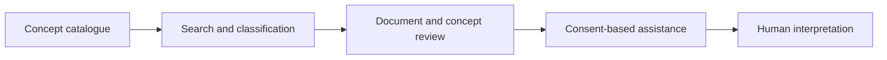

# Conceptual knowledge architecture

This is a conceptual portfolio diagram, not production topology. The original project documentation describes a digital theory catalogue, local PDF reader, consent-based conversation tools and bounded AI/research gateway. Private implementation, unpublished manuscripts, original theories and gateway configuration are excluded. Proposed theories are conceptual frameworks, not established scientific laws.
